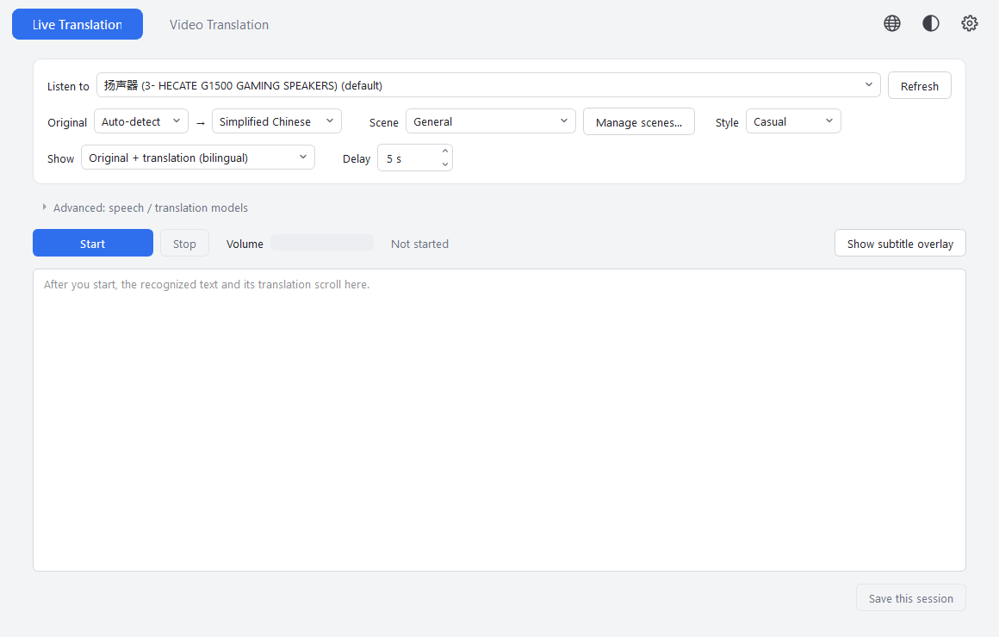
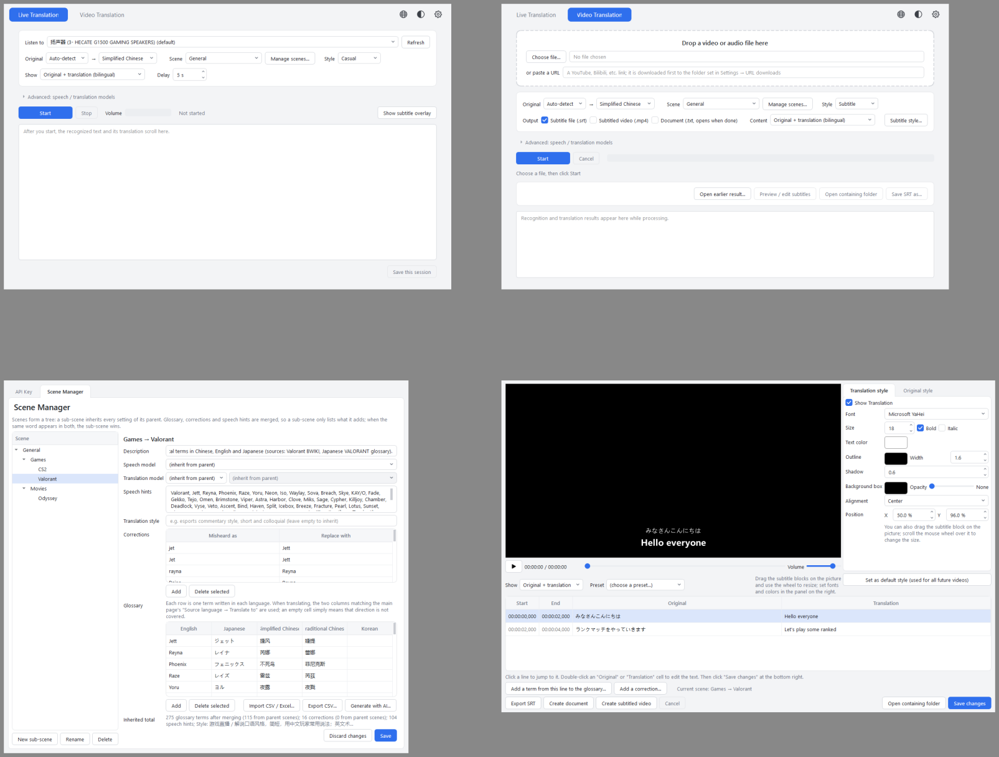

<div align="center">

# SubTranslator

**Turn speech in videos and livestreams into subtitles you can read.**

Japanese / English → Simplified Chinese, Traditional Chinese, English, Japanese, Korean · Local files · URLs · Livestreams · Windows

[中文说明](README_cn.md) · [Download](https://github.com/skychenqianhang-hub/Subtitle-translator/releases/latest)

</div>



## Features

- **Video translation** — a local video / audio file or a YouTube / Bilibili URL → `.srt` subtitles, a video with burned-in subtitles, or a side-by-side document.
- **Live translation** — captures whatever your PC is playing (any site, no plug-ins) and shows translated subtitles in a draggable overlay a few seconds later.
- **Subtitle designer** — drag subtitles on the picture like a slide, set font, size, colour, outline and position, then render the video.
- **Scenes** — presets for games (Valorant, CS2), movies and more, each with its own glossary, corrections and speech hints; "Auto" picks a scene from what it hears.
- **Multilingual glossaries** — one row per term with its spelling in each language (EN / JA / ZH-Hans / ZH-Hant / KO); CSV / Excel import and export.
- **AI-generated glossaries** — type "League of Legends" or "the movie Dune: Part Two"; Claude searches official sources and builds a sourced glossary for you to review.
- Four translation styles (casual / subtitle / semi-formal / formal), live cost display, UI in Chinese / Japanese / English, three colour themes.



## How it works

```
audio ──► speech recognition (OpenAI gpt-4o-transcribe / gpt-transcribe / whisper)
      ──► scene corrections, sentence assembly
      ──► translation (Claude Sonnet / Opus or GPT) + glossary + style
      ──► subtitles (.srt / burned-in video / document / overlay)
```

Recognition and translation run on cloud APIs with **your own API keys**; the app itself is free. Rough costs: about $0.005 per minute of audio for recognition, about $0.3 per hour of video for translation with Claude Sonnet 5.5. The exact cost of every run is shown when it finishes.

## Install

1. Download `SubTranslator-Setup-x.y.z.exe` from [Releases](https://github.com/skychenqianhang-hub/Subtitle-translator/releases/latest) and run it. Windows may warn about an unknown publisher (the installer is not code-signed): choose "More info → Run anyway".
2. Open the app, click the gear → **API Key**, and paste:
   - an **OpenAI** key (required for speech recognition; also used when GPT is chosen for translation) — create one at [platform.openai.com](https://platform.openai.com/api-keys);
   - an **Anthropic** key (used when Claude is chosen for translation, and always for AI-generated glossaries) — [console.anthropic.com](https://console.anthropic.com/settings/keys).

   Keys are stored only on your PC in `%APPDATA%\SubTranslator\config.json`.

Requires Windows 10 / 11 (64-bit). ffmpeg is bundled.

## Usage

**Video**: drop a file (or paste a URL) → choose source → target language, scene and style, tick the outputs → **Start**. The subtitle editor opens when it finishes; outputs are written next to the video (`name.srt`, `name.双语字幕.mp4`, `name.字幕工程.json` — the suffixes are fixed regardless of UI language).

**Live**: pick the speaker / headset you are listening on → **Start**. Subtitles appear in the overlay; drag it anywhere, scroll to resize. "Delay" is how much audio to collect before each recognition (5–8 s recommended). Save the session as `.srt` + `.txt` afterwards.

**Scenes & glossaries**: gear → **Scene manager**. Scenes form a tree and inherit from their parent. Each scene has a multilingual glossary, corrections (`jet` → `Jett`), speech hints and an optional style / model override. "Generate with AI…" builds a glossary from official web sources (about $0.4–0.5 for 120 terms).

## Build from source

```bash
pip install -r requirements.txt          # Python 3.11
python -m app.main
python -m tests.test_skeleton            # each file under tests/ is a suite; none costs money
python -m PyInstaller --noconfirm --clean SubTranslator.spec
python installer/build_installer.py      # needs Inno Setup 6
```

## License

[MIT](LICENSE).

## Credits

[PySide6](https://doc.qt.io/qtforpython/) · [ffmpeg](https://ffmpeg.org/) · [yt-dlp](https://github.com/yt-dlp/yt-dlp) · [Silero VAD](https://github.com/snakers4/silero-vad) · [OpenAI](https://platform.openai.com/) · [Anthropic](https://www.anthropic.com/). Built with help from [Claude Code](https://claude.com/claude-code).
