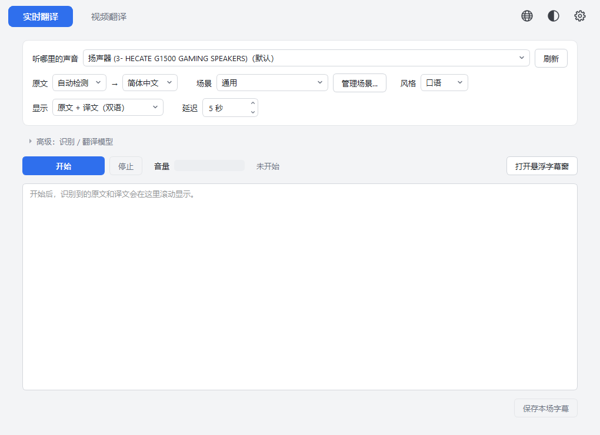
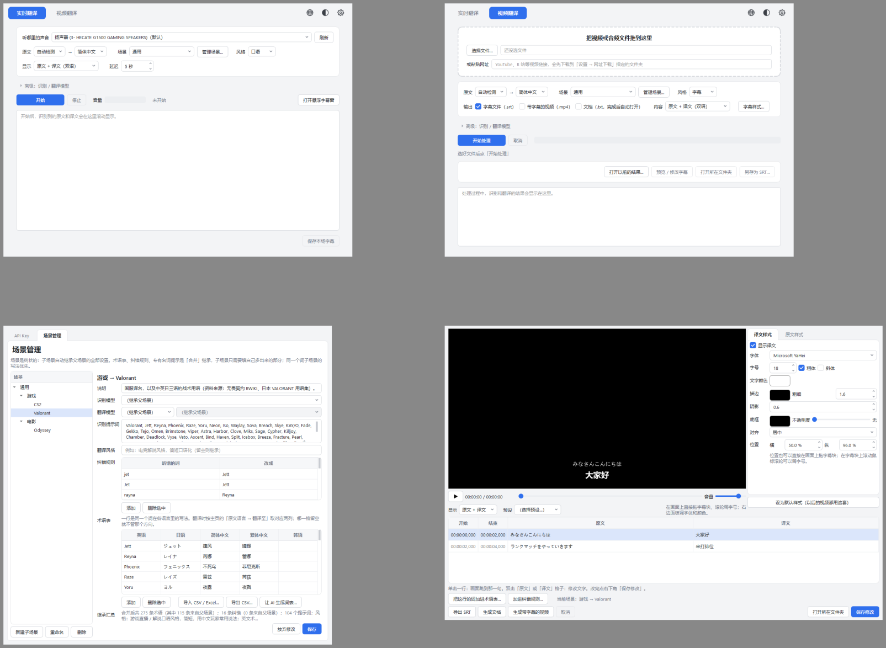

<div align="center">

# 字幕翻译器 SubTranslator

**把视频和直播里说的话，变成你看得懂的字幕。**

日语 / 英语 → 简体中文、繁体中文、英语、日语、韩语 ｜ 本地视频 · 网址 · 直播 ｜ Windows

[English](README_en.md) · [下载安装包](https://github.com/skychenqianhang-hub/Subtitle-translator/releases/latest) · [使用说明](#使用) · [常见问题](#常见问题)

</div>



## 它能做什么

- **视频翻译**：把本地视频 / 音频文件，或 YouTube、B 站等网址，整段识别 + 翻译，输出 `.srt` 字幕文件、烧好字幕的视频、或一篇原文 / 译文对照文档。
- **实时翻译**：看直播或在线视频时，抓取电脑正在播放的声音，几秒后字幕出现在一个可以拖动的悬浮窗里。任何平台都能用，不用插件。
- **字幕设计器**：像编辑一页幻灯片一样，在画面上直接拖字幕、调字体、大小、颜色、位置、描边，再生成带字幕的视频。
- **内容场景**：游戏（Valorant、CS2）、电影等场景自带术语表、纠错规则和识别提示词，译名统一；还能「自动」按内容判断场景。
- **多语言术语表**：一行一个词在各语言里的写法（英 / 日 / 简 / 繁 / 韩），翻到哪种语言就用哪一列；支持 CSV / Excel 导入导出。
- **让 AI 生成词表**：填一句「英雄联盟」或「电影《沙丘 2》」，Claude 联网查官方资料，整理成带来源的多语言术语表，预览确认后入库。
- **译文风格**四档：口语 / 字幕 / 半正式 / 正式。
- 费用实时显示；中文 / 日本語 / English 三种界面语言；三套配色。



## 它是怎么工作的

```
声音 ──► 语音识别（OpenAI gpt-4o-transcribe / gpt-transcribe / whisper）
      ──► 按场景纠错、整理成句
      ──► 翻译（Claude Sonnet / Opus，或 GPT）+ 术语表 + 风格
      ──► 字幕（.srt / 烧录视频 / 文档 / 悬浮窗）
```

识别和翻译都走云端接口，**需要你自己的 API Key**；软件本身不收费。费用大致是：识别每分钟 $0.005 左右，翻译一小时视频约 $0.3（Claude Sonnet 5.5）。每次处理完都会显示本次花了多少。

## 安装

1. 到 [Releases](https://github.com/skychenqianhang-hub/Subtitle-translator/releases/latest) 下载 `SubTranslator-Setup-x.y.z.exe`。
2. 双击安装。Windows 可能提示「未知发布者」，点「更多信息 → 仍要运行」（安装包没有购买数字签名）。
3. 第一次打开，点右上角齿轮 → **API Key**，填入：
   - **OpenAI** 的 Key（语音识别必需；翻译选 GPT 时也用它）——在 [platform.openai.com](https://platform.openai.com/api-keys) 创建并充值。
   - **Anthropic** 的 Key（翻译选 Claude 时需要；「让 AI 生成词表」固定用它）——在 [console.anthropic.com](https://console.anthropic.com/settings/keys) 创建并充值。

   Key 只保存在你电脑的 `%APPDATA%\SubTranslator\config.json` 里，不会上传到任何地方。

系统要求：Windows 10 / 11（64 位）。ffmpeg 已内置，不需要另外安装。

## 使用

### 视频翻译
1. 把视频拖进窗口，或点「选择文件…」，或粘贴网址。
2. 选「原文 → 译成」、场景、风格；勾选要输出什么（字幕文件 / 带字幕的视频 / 文档）。
3. 点「开始处理」。完成后自动打开字幕编辑器，可以改字幕、调样式，再导出。
4. 输出文件都放在视频旁边：`视频名.srt`、`视频名.双语字幕.mp4`、`视频名.字幕工程.json`（下次可以「打开以前的结果…」继续改）。

### 实时翻译
1. 「听哪里的声音」选你正在用的扬声器或耳机（和 Windows 右下角选扬声器是同一份列表）。
2. 选语言、场景，点「开始」。字幕出现在悬浮窗里，可以拖到任何位置，滚轮调字号。
3. 「延迟」是最多攒多长的声音再送去识别：越短字幕越快，句子越容易被切断，建议 5–8 秒。
4. 结束后可以「保存本场字幕」为 `.srt` 和 `.txt`。

### 场景与术语表
齿轮 → **场景管理**。场景是树状的：子场景继承父场景的全部设置，只需要填自己多出来的部分。每个场景可以有：
- **术语表**：一行一个词在各语言的写法；翻译时按「原文 → 译成」取对应两列。
- **纠错规则**：识别经常听错的词（如 `jet` → `Jett`）。
- **识别提示词**：人名、地图名等专有名词，告诉识别模型这些词会出现。
- **翻译风格**、指定模型。

「让 AI 生成词表…」：填领域描述 → Claude 联网查官方资料 → 预览（每行带来源网址和把握程度）→ 删掉不要的 → 加进术语表。一张 120 条的表大约 $0.4–0.5。

## 常见问题

**识别出来是空的 / 「没有检测到任何说话的声音」** — 视频可能只有音乐；或实时翻译选错了设备（看「音量」条有没有动）。

**Windows 说这个程序不安全** — 安装包没有数字签名，点「更多信息 → 仍要运行」。源代码在这里，也可以自己打包。

**网址下载失败** — 下载靠 [yt-dlp](https://github.com/yt-dlp/yt-dlp)，网站改版后可能失效，等更新版本；或先用浏览器插件把视频下载到本地再翻。

**费用怎么算** — 识别按分钟，翻译按字数。处理完的日志末尾有本次的明细。

**我的 Key 安全吗** — 只存在本机 `%APPDATA%\SubTranslator\config.json`，只发给 OpenAI / Anthropic 官方接口。

## 从源代码运行 / 打包

```bash
# Python 3.11，建议 conda 环境
pip install -r requirements.txt
python -m app.main                      # 运行
python -m tests.test_skeleton           # 自动测试（tests/ 下每个文件都是一套，不花钱）
python -m PyInstaller --noconfirm --clean SubTranslator.spec    # 打包到 dist/SubTranslator
python installer/build_installer.py     # 再打成安装包（需要 Inno Setup 6）
```

开发时需要本机有 ffmpeg（`winget install Gyan.FFmpeg.Essentials`）。

## 许可证

[MIT](LICENSE)。可以自由使用、修改、分发，保留署名即可。

## 致谢

[PySide6](https://doc.qt.io/qtforpython/) · [ffmpeg](https://ffmpeg.org/) · [yt-dlp](https://github.com/yt-dlp/yt-dlp) · [Silero VAD](https://github.com/snakers4/silero-vad) · [OpenAI](https://platform.openai.com/) · [Anthropic](https://www.anthropic.com/) · 词表资料来源见 `profiles/*.yaml` 的 description。

本软件由 [Claude Code](https://claude.com/claude-code) 协助开发。
